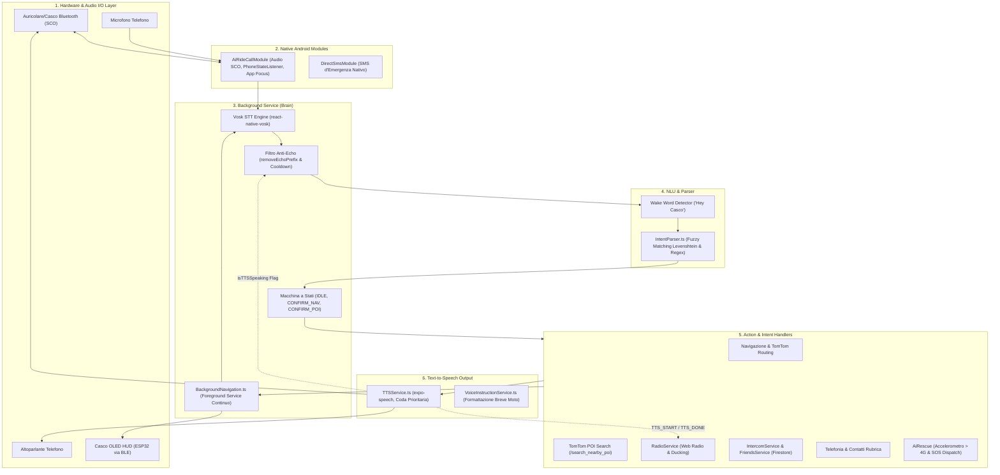
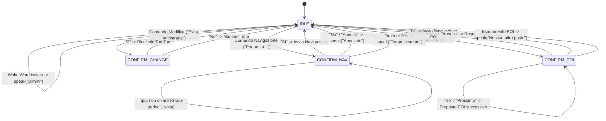

# 🎙️ Specifiche Tecniche, Architettura e Funzioni dell'Assistente Vocale AiRide

Il presente documento costituisce la specifica tecnica esaustiva del **Sistema di Assistenza Vocale Intelligente Hands-Free** integrato nell'ecosistema **AiRide**. Il sistema è stato progettato e ottimizzato specificamente per la guida motociclistica, operando in ambienti acustici ad alto rumore (vento aerodinamico, rombo del motore, visiera del casco) e consentendo al motociclista il pieno controllo delle funzionalità di navigazione, telemetria, comunicazione e sicurezza senza mai staccare le mani dal manubrio né distogliere lo sguardo dalla strada.

---

## 📑 Indice dei Contenuti
1. [Panoramica e Obiettivi di Progetto](#1-panoramica-e-obiettivi-di-progetto)
2. [Architettura di Sistema a Livelli](#2-architettura-di-sistema-a-livelli)
3. [Componenti Software e Flussi Dati](#3-componenti-software-e-flussi-dati)
4. [Motore Speech-to-Text (STT) e Wake Word Engine](#4-motore-speech-to-text-stt-e-wake-word-engine)
5. [Natural Language Understanding (NLU) e Macchina a Stati](#5-natural-language-understanding-nlu-e-macchina-a-stati)
6. [Motore Text-to-Speech (TTS) e Sintesi delle Istruzioni](#6-motore-text-to-speech-tts-e-sintesi-delle-istruzioni)
7. [Integrazione Audio Hardware, Bluetooth SCO e Audio Ducking](#7-integrazione-audio-hardware-bluetooth-sco-e-audio-ducking)
8. [Catalogo Funzionale Completo dei Comandi Vocali](#8-catalogo-funzionale-completo-dei-comandi-vocali)
   - [8.1 Navigazione e Controllo Percorso](#81-navigazione-e-controllo-percorso)
   - [8.2 Ricerca Punti di Interesse (POI) con Carosello Dinamico](#82-ricerca-punti-di-interesse-poi-con-carosello-dinamico)
   - [8.3 Telemetria di Guida e Stato Dispositivi](#83-telemetria-di-guida-e-stato-dispositivi)
   - [8.4 Chiamate Telefoniche Vivavoce e Rubrica](#84-chiamate-telefoniche-vivavoce-e-rubrica)
   - [8.5 Streaming Web Radio e Controllo Volume](#85-streaming-web-radio-e-controllo-volume)
   - [8.6 Interfono Vocale Hands-Free e Radar Compagni](#86-interfono-vocale-hands-free-e-radar-compagni)
   - [8.7 Sistema Salvavita AiRescue (Crash Response)](#87-sistema-salvavita-airescue-crash-response)
   - [8.8 Controllo Vocale dell'Assistente (Mute/Unmute)](#88-controllo-vocale-dellassistente-muteunmute)
9. [Internazionalizzazione (i18n) e Gestione Modelli Offline](#9-internazionalizzazione-i18n-e-gestione-modelli-offline)
10. [Sicurezza Operativa, Prevenzione Concorrenza e Protezione OTA](#10-sicurezza-operativa-prevenzione-concorrenza-e-protezione-ota)
11. [Matrice dei File e Componenti del Repository](#11-matrice-dei-file-e-componenti-del-repository)

---

## 1. Panoramica e Obiettivi di Progetto

L'Assistente Vocale AiRide risponde a requisiti ingegneristici stringenti:
- **Operatività 100% Offline (Edge STT):** I comandi vocali devono essere compresi istantaneamente anche in passi di montagna, gallerie o zone prive di copertura cellulare (4G/5G).
- **Zero Distrazioni (Hands-Free Totale):** Attivazione tramite Wake Word ("Hey Casco" / "Ciao Casco") e dialogo a turni per le conferme, senza richiedere interazioni touch sui guanti da moto.
- **Resilienza al Rumore del Vento e del Motore:** Utilizzo di algoritmi di matching fonetico e distanza di Levenshtein, uniti a una grammatica ristretta per la wake word volta a prevenire falsi positivi acustici.
- **Prioritizzazione dei Messaggi:** Messaggi critici (allerte incidente AiRescue o indicazioni immediate di svolta) interrompono istantaneamente notifiche ordinarie o riproduzioni secondarie.
- **Coordinamento Acustico Centralizzato:** Gestione attiva dell'Audio Ducking per abbassare lo streaming musicale quando l'assistente ascolta o parla, e gestione dell'Anti-Echo per impedire al microfono di riascoltare la voce sintetizzata dell'app.

---

## 2. Architettura di Sistema a Livelli



---

## 3. Componenti Software e Flussi Dati

L'infrastruttura dell'assistente vocale è suddivisa in moduli specializzati:

| Modulo | File Principale | Ruolo Tecnico |
| :--- | :--- | :--- |
| **STT Engine & Daemon** | [BackgroundNavigation.ts](file:///d:/airide/airide-native/services/BackgroundNavigation.ts) | Esegue il servizio di background ininterrotto, inizializza Vosk, gestisce la macchina a stati conversazionale e coordina il GPS/BLE. |
| **NLU & Intent Parser** | [IntentParser.ts](file:///d:/airide/airide-native/utils/IntentParser.ts) | Tokenizza ed estrae gli intenti semantici dai testi trascritti con supporto multilingua e tolleranza fuzzy. |
| **TTS Core** | [TTSService.ts](file:///d:/airide/airide-native/services/TTSService.ts) | Gestisce la coda asincrona dei messaggi vocali, ordina per priorità ed esegue il fallback dinamico dei motori vocali. |
| **Generatore Frasi Nav** | [VoiceInstructionService.ts](file:///d:/airide/airide-native/services/VoiceInstructionService.ts) | Converte le svolte geometriche in istruzioni vocali concise e adatte alla guida, calcolando gli scaglioni di distanza. |
| **Download Modelli STT** | [VoskModelManager.ts](file:///d:/airide/airide-native/services/VoskModelManager.ts) | Gestisce lo scaricamento HTTP e l'estrazione locale degli archivi `.zip` dei modelli linguistici Vosk (EN, FR, DE, ES). |
| **Telefonia & Audio SCO** | [AiRideCallModule.java](file:///d:/airide/airide-native/android/app/src/main/java/com/anonymous/airidenative/AiRideCallModule.java) | Modulo nativo Android per il controllo di chiamate, routing su auricolari casco via Bluetooth SCO e ripristino del focus visivo. |
| **Audio Ducking & Radio** | [RadioService.ts](file:///d:/airide/airide-native/services/RadioService.ts) | Player multimediale con sincronizzazione automatica del volume durante l'ascolto e la pronuncia dell'assistente. |
| **Interfono Hands-free** | [IntercomService.ts](file:///d:/airide/airide-native/services/IntercomService.ts) | Gestione del canale audio vocale PTT/VOX via Firestore tra membri dello stesso gruppo moto o comunicazioni 1-a-1. |
| **Sicurezza AiRescue** | [AiRescueContext.tsx](file:///d:/airide/airide-native/contexts/AiRescueContext.tsx) | Pipeline di risposta all'incidente: impatto sensori -> interrogazione vocale -> ascolto di cancellazione -> dispatch Twilio/SMS. |
| **UI & Orchestrazione** | [index.tsx](file:///d:/airide/airide-native/app/(tabs)/index.tsx) | Raccoglie gli eventi `Voice_Intent` e guida l'interfaccia utente (mappa, marker amici, widget radio, card svolte). |

---

## 4. Motore Speech-to-Text (STT) e Wake Word Engine

### 4.1 Motore Vosk Offline
Il riconoscimento vocale si basa sulla libreria open-source **Vosk** (`react-native-vosk`), basata su modelli acustici e dizionari fonetici Kaldi:
- **Esecuzione Locale:** Funziona interamente sulla CPU del dispositivo Android senza richiedere server esterni o connessione dati attiva.
- **Modello Base Bundled:** Il modello ridotto italiano (`vosk-model-small-it-0.22`) è integrato direttamente negli asset dell'APK Android (`android/app/src/main/assets/model`), garantendo operatività immediata post-installazione.
- **Riconoscimento Streaming:** Vosk analizza i campioni PCM a 16kHz in blocchi continui tramite due callback native:
  - `onPartialResult`: Trascrizione preliminare a bassa latenza, utilizzata per agganciare la Wake Word al volo.
  - `onResult`: Risultato definitivo stabilizzato dell'enunciato, inviato al parser di intenti.

### 4.2 Wake Word Rigorosa
Per evitare che il rumore aerodinamico del casco o il rombo dello scarico aprano involontariamente il microfono, la regex della wake word è stata calibrata escludendo vocali isolate:
```typescript
public static readonly WAKE_WORD_REGEX = /\b(hey|ehy|ehi|hei|ok|ciao)(\s+(il|mio))?\s+casco\b/i;
```
Quando la wake word viene rilevata:
1. Viene registrato il timestamp `lastWakeWordTime = Date.now()`.
2. Si apre la finestra di ascolto per un intervallo di **6.000 ms** (`WAKE_WORD_WINDOW`).
3. L'assistente risponde con un prompt breve ("*Dimmi*") ed emette l'evento globale `Voice_Status: { status: 'listening' }`, che visualizza a schermo il banner animato *«Ti ascolto...»*.
4. Qualora l'utente pronunci direttamente la wake word seguita dal comando (es. *"Hey casco portami a Milano"*), la frase viene divisa tramite `stripWakeWord()` e il comando viene processato immediatamente in un unico ciclo senza latenze.

### 4.3 Sistema Anti-Echo e Disaccoppiamento Acustico
Un problema noto dei sistemi vivavoce su due ruote è il "loop acustico", in cui il microfono del casco cattura la voce dell'assistente riprodotta negli auricolari. AiRide implementa una tripla barriera protettiva:
1. **Flag Globale `isTTSSpeaking`:** Quando il TTS parla, l'elaborazione dei risultati di Vosk viene scartata a monte.
2. **Cooldown Post-Riproduzione:** Viene imposto un periodo di silenzio minimo (tra 300 ms e 900 ms) dopo la fine della frase sintetica prima di riabilitare l'ascolto.
3. **Filtro di Prefisso `removeEchoPrefix()`:**
   Se l'utente risponde in sovrapposizione al termine della frase, le parole chiave appena pronunciate dal sistema vengono rimosse dall'inizio della stringa trascritta:
   $$\text{Trascrizione: } \text{"rotta verso roma confermi sì"} \xrightarrow{\text{strip eco}} \text{"sì"}$$

---

## 5. Natural Language Understanding (NLU) e Macchina a Stati

### 5.1 Normalizzazione e Correzione Fonetica
Prima dell'analisi semantica, il testo grezzo passa attraverso una pipeline di normalizzazione:
- **Conversione dei Numeri (`numberMap`):** Converte i numeri dettati in cifre arabe (*"via garibaldi dieci"* $\rightarrow$ *"via garibaldi 10"*) in 5 lingue (IT, EN, FR, DE, ES).
- **Correzione Toponimi (`cityFixes`):** Corregge errori tipici di trascrizione acustica delle città (*"hassam"* $\rightarrow$ *"san"*, *"rome"* $\rightarrow$ *"roma"*, *"münchen"* $\rightarrow$ *"monaco"*).
- **Normalizzazione Indirizzi (`normalizeAddress`):** Riconosce prefissi stradali (*via, viale, piazza, corso, boulevard, strasse, avenue, calle*) e riordina civico e comune per renderli compatibili con l'API di geocoding TomTom.

### 5.2 Fuzzy Matching con Tolleranza di Levenshtein
Nei test ad alte velocità, il fruscio del casco altera la pronuncia percepita. Il parser integra una funzione di distanza di Levenshtein (`matchesFuzzy`):
- Per parole $\ge 7$ caratteri: tolleranza di 2 errori di battitura/fonetica.
- Per parole $< 7$ caratteri: tolleranza di 1 errore.
Questo permette di riconoscere comandi essenziali anche con trascrizioni imperfette (es. *"distributre"*, *"recalcola"*, *"spegni interfon"*).

### 5.3 Macchina a Stati Conversazionale (Multi-Turn Dialogue)
La gestione dei dialoghi non è stateless ma governata da una macchina a stati finiti:



- **Finestra di Ascolto Dinamica:** Il timer di timeout della sessione (**20 secondi**, `RESET_SESSION_TIMEOUT`) parte **esclusivamente dopo** che la sintesi vocale ha finito di pronunciare la domanda.
- **Logica di Grazia (Grace Count):** Al primo enunciato non riconosciuto durante una sessione di conferma, il sistema rinnova silenziosamente il timer senza interrompere l'utente; solo al secondo errore consecutivo interviene con un messaggio chiarificatore (*"Non ho capito, confermi?"*).

---

## 6. Motore Text-to-Speech (TTS) e Sintesi delle Istruzioni

### 6.1 Gestione Priorità Coda (`TTSService.ts`)
Tutti i messaggi vocali del sistema passano da un singleton centrale dotato di coda di priorità preemptive:

```typescript
export enum VoicePriority {
  LOW = 0,      // Telemetria di routine, info orario
  NORMAL = 1,   // Istruzioni di svolta a media distanza (>150m)
  HIGH = 2,     // Svolte imminenti (<50m), conferme comandi, chiamate in arrivo
  CRITICAL = 3, // Allarme AiRescue incidente, avviso fuori rotta, emergenze
}
```

- **Preemption Immediata:** Se arriva un messaggio con priorità strettamente superiore rispetto a quello attualmente in riproduzione ($\text{Priority}_{\text{new}} > \text{Priority}_{\text{cur}}$), il sistema arresta immediatamente la voce (`Speech.stop()`) e riproduce il nuovo messaggio senza ritardi.
- **Accodamento Ordinato:** I messaggi `HIGH` e `CRITICAL` ricevuti a canale occupato vengono inseriti in una coda ordinata in modo decrescente per priorità e riprodotti in sequenza al termine della frase corrente.
- **Scarto Intelligente:** Messaggi `LOW` o `NORMAL` che arrivano mentre è in corso una comunicazione d'emergenza vengono scartati per non sovraccaricare il pilota.

### 6.2 Selezione della Voce di Sistema
Il servizio interroga `Speech.getAvailableVoicesAsync()` e ricerca le voci native di sistema per la lingua configurata, dando la priorità a quelle con attributo `quality: "Enhanced"` per garantire la massima comprensibilità anche attraverso altoparlanti da casco di dimensioni contenute.

### 6.3 Ottimizzazione Frasi per Moto (`VoiceInstructionService.ts`)
Le istruzioni stradali TomTom vengono riformulate per il motociclismo:
- **Arrotondamento Metrico:** Sotto i 1000 metri, le distanze sono sempre arrotondate a multipli di **50 metri** (*"tra 250 metri svolta a destra"*). Sotto i 50 metri, l'indicazione della distanza viene omessa per favorire la reattività (*"svolta a destra"*).
- **Frequenza di Guida Configurabile:**
  - `minimal`: vocalizza solo svolte a meno di 50 metri e allarmi critici.
  - `standard`: vocalizza preparazione svolta (300m) e manovra immediata.
  - `verbose`: vocalizza tutti gli aggiornamenti di percorso intermedi.

---

## 7. Integrazione Audio Hardware, Bluetooth SCO e Audio Ducking

### 7.1 Profilo Bluetooth SCO (Headset Casco)
In Android, l'ascolto microfonico e la riproduzione audio tramite auricolari per casco richiedono l'attivazione del profilo sincrono **Bluetooth SCO** (*Synchronous Connection Oriented*). Il modulo [AiRideCallModule.java](file:///d:/airide/airide-native/android/app/src/main/java/com/anonymous/airidenative/AiRideCallModule.java) espone:
- `isBluetoothHeadsetConnected()`: Scansiona i dispositivi di output attivi cercando profili `TYPE_BLUETOOTH_SCO`, `TYPE_BLUETOOTH_A2DP` o cuffie BLE.
- `startBluetoothSco()`: Attiva il canale bidirezionale del microfono del casco all'avvio del riconoscimento vocale.
- `stopBluetoothSco()`: Disattiva il profilo qualora non vi siano auricolari wireless connessi, evitando blocchi degli altoparlanti e microfoni interni dello smartphone.

### 7.2 Coordinamento Audio Ducking
Quando è attiva la Web Radio o la musica in streaming, [RadioService.ts](file:///d:/airide/airide-native/services/RadioService.ts) si sincronizza con l'assistente vocale:
1. **Attivazione Ducking:** Alla ricezione dell'evento `TTS_START` (l'assistente inizia a parlare) o `Voice_Status: listening` (il pilota ha detto *"Hey casco"* e sta parlando), il volume della radio viene abbassato automaticamente al **15%** del livello nominale.
2. **Ripristino Graduale:** All'evento `TTS_DONE` o `Voice_Status: idle`, un timer di rilascio di **800 ms** riporta dolcemente il volume al livello preimpostato, evitando stacchi acustici bruschi.

---

## 8. Catalogo Funzionale Completo dei Comandi Vocali

### 8.1 Navigazione e Controllo Percorso

| Intento | Esempi di Frasi Riconosciute | Azione Eseguita |
| :--- | :--- | :--- |
| `NAVIGATE_TO` | *"Hey casco, portami a Roma"*, *"Portami in via Roma 12 a Milano"*, *"Vai a Firenze"* | Normalizza l'indirizzo, calcola la rotta TomTom, chiede conferma vocale e avvia la navigazione con HUD e mappa. |
| `NAVIGATE_HOME` | *"Hey casco, portami a casa"*, *"Andiamo verso casa"*, *"Rientra a casa"* | Recupera l'indirizzo salvato nelle impostazioni locali e avvia la rotta senza richiedere la pronuncia dell'indirizzo. |
| `NAVIGATE_WORK` | *"Hey casco, vai al lavoro"*, *"Portami in ufficio"* | Recupera l'indirizzo aziendale registrato nel profilo e avvia il tragitto. |
| `REPEAT_INSTRUCTION`| *"Hey casco, ripeti"*, *"Cosa devo fare?"*, *"Dove vado?"*, *"Non ho sentito"* | Pronuncia immediatamente l'ultima istruzione memorizzata con i metri attuali alla svolta. |
| `CANCEL_NAVIGATION` | *"Hey casco, cancella navigazione"*, *"Annulla percorso"*, *"Ferma viaggio"* | Interrompe la sessione di guida, resetta la polyline della mappa e azzera il display HUD del casco. |
| `RECALCULATE_ROUTE` | *"Hey casco, ricalcola rotta"*, *"Trova un'altra strada"* | Richiede all'API TomTom una ricalcolazione dinamica partendo dalla posizione GPS attuale. |
| `CHANGE_ROUTE` | *"Hey casco, evita autostrade"*, *"Evita il pedaggio"* | Ricalcola il tragitto imponendo il vincolo di esclusione dei tratti autostradali a pagamento. |

---

### 8.2 Ricerca Punti di Interesse (POI) con Carosello Dinamico

Il sistema include la gestione interattiva dei POI moto tramite l'endpoint backend dedicato `/search_nearby_poi`:

| Intento | Parole Chiave Attivazione | Comportamento Interattivo |
| :--- | :--- | :--- |
| `FIND_GAS_STATION` | *"Benzina"*, *"Distributore"*, *"Rifornimento"*, *"Ho poca benza"* | Interroga TomTom Search nel raggio di 15 km (categoria `7311`), individua la stazione più vicina e propone: *"Trovato Eni Station a 450 metri. Vuoi andare qui?"* |
| `FIND_FOOD` | *"Ho fame"*, *"Ristorante"*, *"Pizzeria"*, *"Cerca un bar"*, *"Trattoria"* | Ricerca attività ristorative (categoria `7315`) e calcola la distanza stradale. |
| `FIND_MECHANIC` | *"Meccanico"*, *"Officina moto"*, *"Gommista"*, *"Riparazione moto"* | Cerca officine specializzate per motocicli e gommisti nelle vicinanze. |
| `NEXT_POI` | *"Un altro"*, *"Prossimo"*, *"Mostrane un altro"*, *"No"*, *"Cambia posto"* | **Scorrimento Carosello:** Passa istantaneamente al secondo o terzo risultato della lista: *"C'è anche Q8 a 1.2 chilometri. Ti va bene?"* |
| `YES` | *"Sì"*, *"Confermo"*, *"Vai"*, *"Perfetto"*, *"Andiamo"* | Imposta la nuova destinazione, aggiorna l'HUD del casco e inizia la guida. |
| `NO` | *"No"*, *"Annulla"*, *"Lascia stare"*, *"Basta"* | Se pronunciato su una proposta POI scorre al successivo; se ripetuto o confermato cancella la sessione. |

---

### 8.3 Telemetria di Guida e Stato Dispositivi

| Intento | Frasi Esempio | Risposta Vocale dell'Assistente |
| :--- | :--- | :--- |
| `GET_SPEED` | *"A che velocità vado?"*, *"Quanto faccio?"*, *"Velocità attuale"* | Legge la velocità dal ricevitore GPS in km/h (*"Stai viaggiando a 78 chilometri orari"*). |
| `GET_ETA` | *"A che ora arrivo?"*, *"Orario di arrivo"*, *"Quando arriviamo?"* | Calcola l'orario stimato combinando il tempo di percorrenza residuo e l'ora di sistema. |
| `GET_REMAINING_INFO`| *"Quanto manca?"*, *"Chilometri rimanenti"*, *"Distanza residua"* | Vocalizza i chilometri e i minuti mancanti (*"Mancano 14 chilometri e circa 18 minuti"*). |
| `GET_TIME` | *"Che ore sono?"*, *"Che ora è?"* | Pronuncia l'orario corrente (*"Sono le 16 e 42"*). |
| `GET_HELMET_STATUS` | *"Stato del casco"*, *"Batteria casco"*, *"Il casco è connesso?"* | Verifica lo stato della connessione BLE Nordic UART (*"Il casco è connesso e operativo"*). |

---

### 8.4 Chiamate Telefoniche Vivavoce e Rubrica

Il modulo [AiRideCallModule.java](file:///d:/airide/airide-native/android/app/src/main/java/com/anonymous/airidenative/AiRideCallModule.java) si interfaccia con il framework di telefonia nativo (`TelecomManager` / `TelephonyManager`):

| Intento | Comando Vocale | Azione Tecnica Eseguita |
| :--- | :--- | :--- |
| `CALL_CONTACT` | *"Hey casco, chiama Marco"*, *"Telefona a Studio"* | Interroga la rubrica locale (`expo-contacts`), estrae il numero corrispondente, avvia `makeCall()` ed esegue `bringAppToFront(5000)` per riportare AiRide in primo piano rispetto al dialer Android. |
| `ANSWER_CALL` | *"Hey casco, rispondi"*, *"Accetta chiamata"*, *"Pronto"* | Invoca `tm.acceptRingingCall()` via API native Android e richiama in primo piano l'HUD dopo 800 ms. |
| `HANG_UP` | *"Hey casco, chiudi chiamata"*, *"Attacca"*, *"Rifiuta"* | Termina la chiamata telefonica attiva tramite `telecomManager.endCall()`. |

---

### 8.5 Streaming Web Radio e Controllo Volume

Gestito da [RadioService.ts](file:///d:/airide/airide-native/services/RadioService.ts) con 10 emittenti ad alta fedeltà preconfigurate:

| Intento | Esempi di Comandi | Comportamento del Sistema |
| :--- | :--- | :--- |
| `RADIO_PLAY` | *"Hey casco, metti la radio"*, *"Accendi la musica"* | Avvia lo streaming dell'ultima stazione sintonizzata o di Radio Deejay (default). |
| `RADIO_PLAY` (Specifico) | *"Hey casco, metti Ibiza Global"*, *"Metti Radio 105"*, *"Metti Virgin"* | Esegue il matching per nome o parola chiave tra le stazioni (Deejay, Ibiza Global, 105, Virgin, RTL 102.5, RDS, m2o, Radio 24, Capital, Ibiza Sonica). |
| `RADIO_STOP` | *"Hey casco, spegni la radio"*, *"Stoppa la musica"*, *"Silenzia radio"* | Interrompe immediatamente lo streaming audio. Ha priorità logica assoluta rispetto al comando di play. |
| `RADIO_NEXT` / `PREV` | *"Hey casco, cambia stazione"*, *"Radio successiva"*, *"Precedente"* | Passa alla stazione successiva o precedente nella scaletta e ne pronuncia il nome. |
| `RADIO_VOLUME` | *"Hey casco, alza il volume"*, *"Abbassa la musica"*, *"Più forte"* | Modifica il volume con incrementi o decrementi del 15% e vocalizza la percentuale risultante. |
| `RADIO_INFO` | *"Hey casco, che radio sta suonando?"*, *"Info radio"* | Pronuncia il nome dell'emittente corrente e il genere musicale trasmesso. |

---

### 8.6 Interfono Vocale Hands-Free e Radar Compagni

Integrato con [IntercomService.ts](file:///d:/airide/airide-native/services/IntercomService.ts) e [FriendsService.ts](file:///d:/airide/airide-native/services/FriendsService.ts) basato su cloud NoSQL Firestore:

| Intento | Comando Vocale | Funzionalità Eseguita |
| :--- | :--- | :--- |
| `INTERCOM_ON` | *"Ciao casco, accendi interfono"*, *"Attiva interfono"* | Apre il canale vocale di gruppo condiviso con tutti gli amici online del radar. |
| `INTERCOM_WITH_FRIEND` | *"Ciao casco, interfono con Luca"*, *"Parla con Marco"* | Apre un canale audio privato e diretto 1-a-1 deterministico (`[uid1, uid2].sort()`). |
| `INTERCOM_OFF` | *"Ciao casco, spegni interfono"*, *"Chiudi interfono"* | Disattiva la trasmissione audio e libera il microfono. |
| `INTERCOM_STATUS` | *"Ciao casco, chi c'è connesso?"*, *"Stato interfono"* | Elenca vocalmente i nomi dei compagni di moto connessi e attivi nel radar. |
| `INTERCOM_REPLAY` | *"Ciao casco, ripeti ultimo messaggio"*, *"Cosa ha detto?"* | Risollecita l'audio dell'ultimo messaggio ricevuto dai compagni per facilitare l'ascolto col vento. |
| `REACH_FRIEND` | *"Ciao casco, raggiungi Marco"*, *"Vai da Luca"* | Recupera le coordinate GPS in tempo reale condivise dal compagno e calcola la rotta TomTom per raggiungerlo. |

---

### 8.7 Sistema Salvavita AiRescue (Crash Response)

Il sistema di sicurezza AiRescue rappresenta il vertice dell'integrazione hardware-software:
1. **Trigger Fisico:** L'accelerometro del dispositivo campiona a 100 Hz. Se la forza risultante $F_{\text{tot}} = \sqrt{x^2 + y^2 + z^2}$ supera la soglia di **4.0 G**, viene attivato lo stato di incidente.
2. **Interrogazione Vocale ad Alta Priorità:**
   Il sistema emette l'avviso a priorità critica: *"Incidente rilevato. Stai bene?"*.
3. **Ascolto Attivo:**
   Al termine della pronuncia del TTS (`TTS_DONE`), viene invocata la funzione `enableEmergencySTT()`.
   Se l'utente pronuncia parole come *"Sì"*, *"Sto bene"*, *"Tutto bene"*, *"Ok"* o *"Annulla"*, l'allarme viene immediatamente revocato con feedback vocale: *"Allarme annullato. Riprendi il viaggio in sicurezza."*.
4. **Countdown e Invio Emergenza Automatico:**
   Se entro **30 secondi** non viene rilevata alcuna risposta vocale (e nessun tocco sullo schermo):
   - Viene tentato l'invio diretto di un SMS con link Google Maps della posizione tramite il modulo nativo Android [DirectSmsModule.java](file:///d:/airide/airide-native/android/app/src/main/java/com/anonymous/airidenative/DirectSmsModule.java).
   - In caso di assenza di SIM abilitata o diniego dei permessi, interviene il fallback cloud inviando la richiesta al backend Flask (`/emergency_call`), che provvede al dispatch dell'SMS ai contatti registrati tramite l'infrastruttura **Twilio**.

---

### 8.8 Controllo Vocale dell'Assistente (Mute/Unmute)

| Intento | Comando Vocale | Effetto |
| :--- | :--- | :--- |
| `TOGGLE_VOICE_MUTE` (Mute) | *"Hey casco, silenzia voce"*, *"Non parlare"*, *"Muta assistente"*, *"Zitto"* | Disattiva temporaneamente la pronuncia vocale delle istruzioni di navigazione, mantenendo attivo il display HUD. |
| `TOGGLE_VOICE_MUTE` (Unmute) | *"Hey casco, attiva voce"*, *"Riattiva voce"*, *"Parla"* | Riabilita la vocalizzazione delle manovre stradali. |

---

## 9. Internazionalizzazione (i18n) e Gestione Modelli Offline

AiRide supporta 5 lingue complete sia in ricezione (STT) sia in sintesi vocale (TTS):

| Lingua | Codice | Modello Vosk Utilizzato | Dimensione | Stato di Installazione |
| :---: | :---: | :--- | :---: | :--- |
| 🇮🇹 **Italiano** | `it` | `vosk-model-small-it-0.22` | ~42 MB | **Pre-installato (Bundled)** negli asset dell'APK |
| 🇬🇧 **Inglese** | `en` | `vosk-model-small-en-us-0.15` | 40 MB | Scaricabile On-Demand via [VoskModelManager.ts](file:///d:/airide/airide-native/services/VoskModelManager.ts) |
| 🇫🇷 **Francese** | `fr` | `vosk-model-small-fr-0.22` | 41 MB | Scaricabile On-Demand via [VoskModelManager.ts](file:///d:/airide/airide-native/services/VoskModelManager.ts) |
| 🇩🇪 **Tedesco** | `de` | `vosk-model-small-de-0.15` | 45 MB | Scaricabile On-Demand via [VoskModelManager.ts](file:///d:/airide/airide-native/services/VoskModelManager.ts) |
| 🇪🇸 **Spagnolo** | `es` | `vosk-model-small-es-0.42` | 39 MB | Scaricabile On-Demand via [VoskModelManager.ts](file:///d:/airide/airide-native/services/VoskModelManager.ts) |

### Procedura di Hot-Swap del Modello:
Quando l'utente seleziona una lingua diversa dalla schermata Impostazioni:
1. `VoiceSettingsContext` emette l'evento `VoiceSettings_Updated`.
2. Il servizio `BackgroundNavigation` intercetta l'evento.
3. Se il modello per la nuova lingua è presente su disco, invoca `stopVosk()`, attende 500 ms di pulizia della memoria, carica il nuovo modello con `loadModel(path)` e riavvia `startVosk()`, completando l'hot-swap del motore vocale senza richiedere il riavvio dell'applicazione.

---

## 10. Sicurezza Operativa, Prevenzione Concorrenza e Protezione OTA

Durante l'esecuzione sono implementati controlli architetturali per evitare conflitti e crash di sistema:
1. **Protezione Aggiornamenti Firmware OTA:**
   Durante l'aggiornamento wireless del firmware dell'ESP32 del casco (`BleOtaService`), la trasmissione continua di campioni vocali e pacchetti BLE di navigazione provocherebbe il blocco della coda BLE o crash per overflow di allocazione C++ (`__next_prime`).
   L'evento `OtaStateChanged` arresta in modo pulito Vosk (`safeStopVosk`) e sospende l'invio di pacchetti BLE. Al completamento del flashing, Vosk viene ripristinato automaticamente dopo 3 secondi di stabilizzazione.
2. **Priorità Chiamate e Vivavoce:**
   Il listener nativo `PhoneStateListener` invia l'evento `CallStatusChanged`. Se il telefono entra in stato di chiamata attiva o suoneria, la vocalizzazione delle svolte superflue viene temporizzata per non coprire la conversazione del pilota.

---

## 11. Matrice dei File e Componenti del Repository

```
d:\airide\
├── AiRide_Voice_Assistant_Specifications.md      # Questo documento tecnico ufficiale
├── AiRideHelmet_v2\
│   └── AiRideHelmet_v2.ino                       # Firmware casco ESP32 (Ricezione BLE Nordic UART & Display OLED)
├── backend\
│   └── app.py                                    # Server Flask: routing TomTom, /search_nearby_poi, SOS Twilio
└── airide-native\
    ├── android\app\src\main\
    │   ├── assets\model\vosk-model-small-it-0.22 # Modello vocale offline italiano preinstallato
    │   └── java\com\anonymous\airidenative\
    │       ├── AiRideCallModule.java             # Gestore nativo chiamate, focus app e Bluetooth SCO
    │       └── DirectSmsModule.java              # Invio SMS d'emergenza in background
    ├── components\
    │   ├── VoiceCommandsModal.tsx                # Scheda modale con guida e comandi vocali
    │   └── RadioPlayerWidget.tsx                 # Mini-player radio reattivo
    ├── contexts\
    │   ├── VoiceSettingsContext.tsx              # Stato e persistenza delle impostazioni vocali
    │   ├── AiRescueContext.tsx                   # Rilevamento caduta e interazione vocale SOS
    │   └── HelmetContext.tsx                     # Connessione Bluetooth Low Energy con l'HUD
    ├── hooks\
    │   ├── useVoiceAssistant.ts                  # Hook TTS per le svolte di navigazione
    │   ├── useVoiceCommand.ts                    # Hook STT che ascolta gli eventi dal background
    │   └── useVoiceCommand_VOSK_ONLY.ts          # Driver Vosk standalone
    ├── services\
    │   ├── BackgroundNavigation.ts               # Cervello in background: ciclo GPS, Vosk, NLU, Dialoghi
    │   ├── TTSService.ts                         # Servizio sintesi vocale con coda di priorità
    │   ├── VoiceInstructionService.ts            # Generazione frasi brevi per motociclisti
    │   ├── VoskModelManager.ts                   # Download ed estrazione modelli multilingua
    │   ├── RadioService.ts                       # Web radio con Audio Ducking
    │   ├── IntercomService.ts                    # Interfono hands-free via Firestore
    │   ├── FriendsService.ts                     # Gestione radar e posizioni GPS amici
    │   └── callModule.js                         # Interfaccia JS per il modulo nativo Android
    ├── types\
    │   └── voice.ts                              # Definizioni TypeScript per priorità e impostazioni
    └── utils\
        └── IntentParser.ts                       # NLU, Wake Word, regex multilingua, Levenshtein fuzzy match
```

---
*Documento compilato e validato per il codebase AiRide. Tutte le architetture, firme di funzioni e protocolli descritti riflettono fedelmente l'implementazione attiva nei sorgenti di progetto.*
